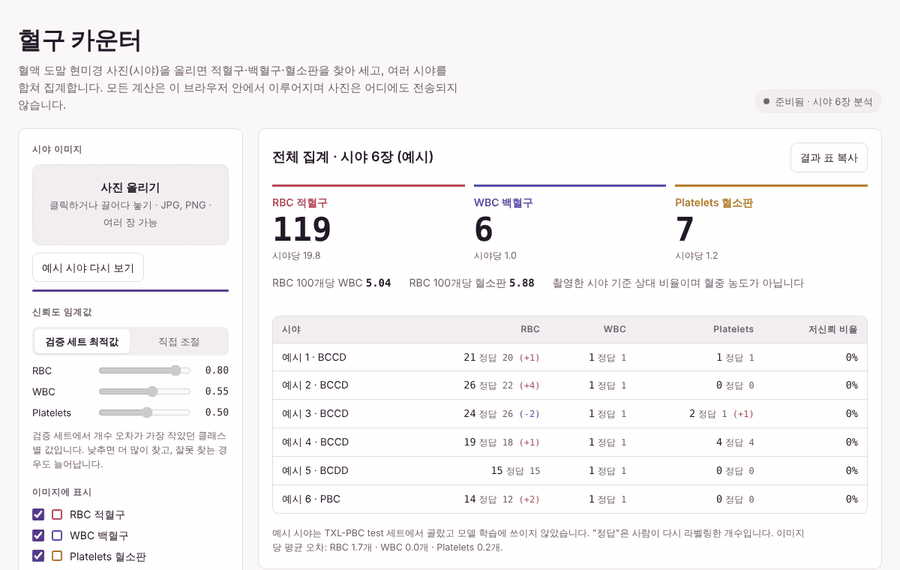
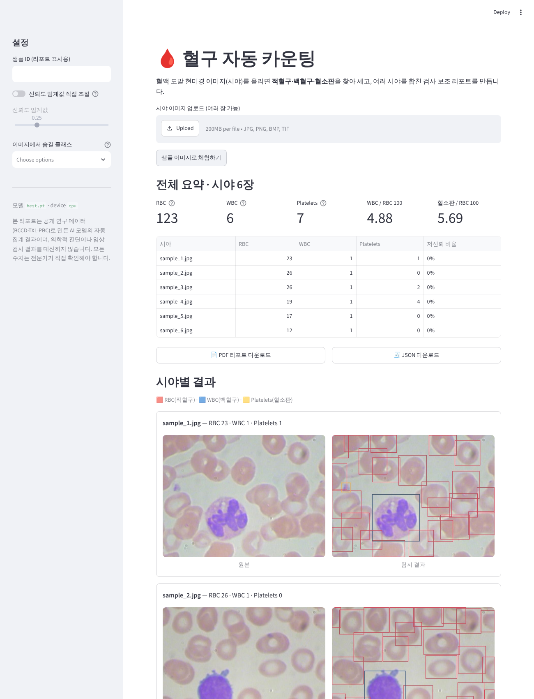
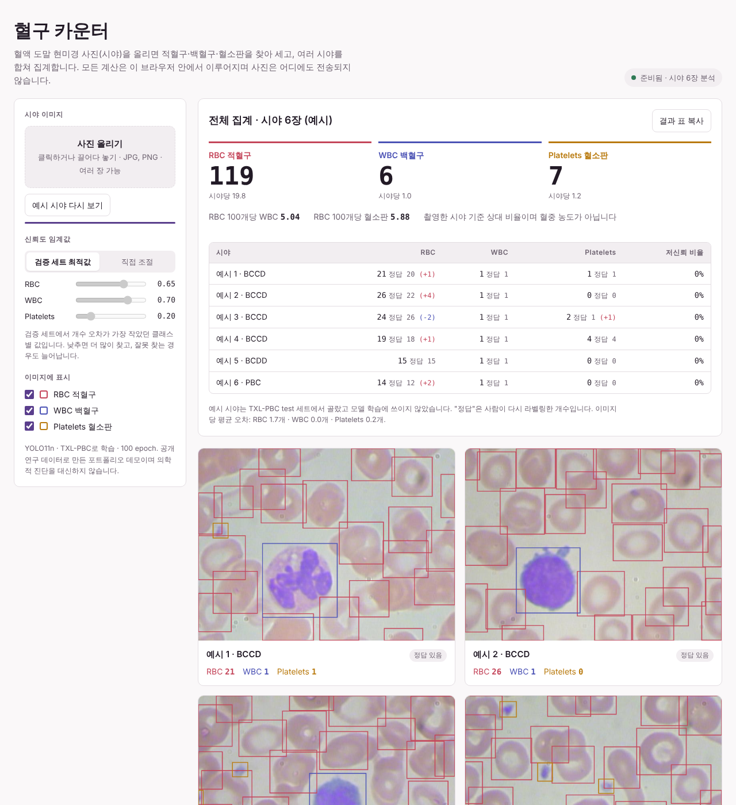
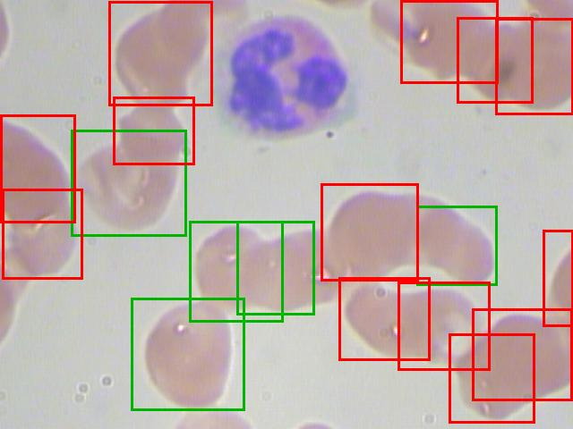
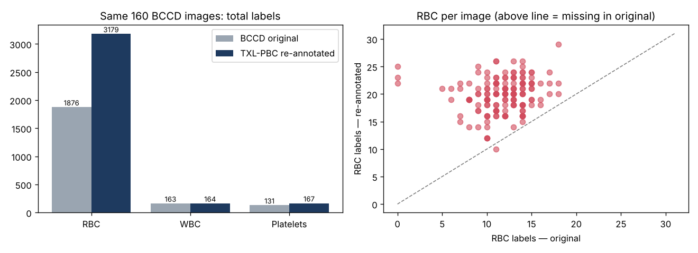
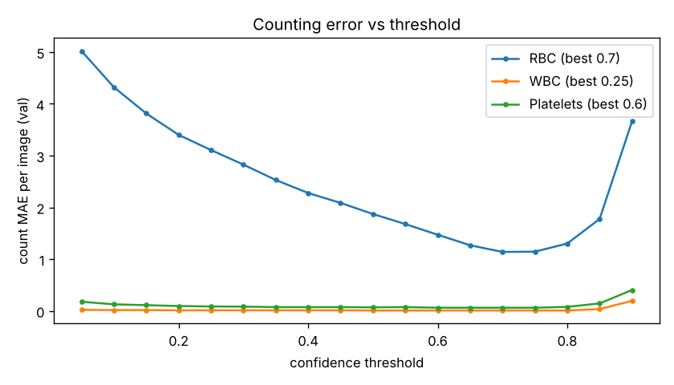
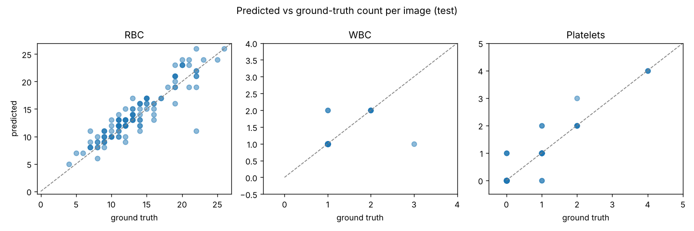

# 🩸 Blood Cell Counter — 혈액 도말 이미지 혈구 자동 카운팅

혈액 도말 현미경 이미지를 올리면 **적혈구(RBC)·백혈구(WBC)·혈소판(Platelets)** 을 YOLO11로 탐지해 세고,
여러 시야를 합친 **검사 보조 PDF 리포트**를 만들어 주는 서비스입니다.

> ⚠️ 공개 연구 데이터로 만든 포트폴리오 프로젝트입니다. 의학적 진단을 대신하지 않습니다.
>
>    🔗 **바로 써보기: [gyeong061.github.io/bloodcell-counter](https://gyeong061.github.io/bloodcell-counter/)** — 설치 없이 브라우저에서 동작하며, 올린 사진은 외부로 전송되지 않습니다.



*예시 시야 분석 → 클래스별 표시 끄고 켜기 → 임계값을 바꾸면 다시 추론하지 않고 개수가 바로 바뀜 → 새 사진 2장 올려 분석*

| 웹 앱 (Streamlit · YOLO11s) | 브라우저 데모 (YOLO11n) |
|---|---|
|  |  |

## 한눈에 보기

1. **문제 정의** — "박스를 잘 치는 모델"이 아니라 "개수를 정확히 세는 서비스". mAP와 함께 이미지별 개수 오차를 직접 설계해 평가
2. **데이터를 의심하기** — BCCD로 시작했다가 RBC 개수가 이상하게 맞는 현상을 추적 → 정답 라벨의 RBC 누락 + 오류 상쇄를 발견
3. **원인 해결과 검증** — 다시 라벨링된 TXL-PBC로 교체하고, **이미지는 같고 라벨만 다른 통제 실험**을 시드 3개로 반복해 효과(RBC Recall +9%p)와 효과가 없는 부분(개수 오차)을 구분
4. **결과를 의심하기** — 시드 반복으로 재현되지 않는 개선을 걸러내고, 임계값 탐색 범위 실수를 찾아 과장된 결론(오차 −1.10 → 실제 −0.21)을 바로잡음
5. **끝까지 만들기** — 학습 → 평가 → REST API → 웹 앱·PDF 리포트 → 설치 없는 브라우저 데모

**최종 모델 (TXL-PBC test 124장)**: YOLO11s · mAP50 0.990 · 이미지당 개수 오차 RBC 1.39개, WBC 0.03개, 혈소판 0.07개

## 주요 기능

| 기능 | 설명 |
|---|---|
| 혈구 탐지·카운팅 | 시야별 RBC·WBC·혈소판 개수, 클래스별 색 박스 |
| 여러 시야 집계 | 합계, 시야당 평균, RBC 100개당 WBC·혈소판 비율 |
| 검토 필요 표시 | RBC 과소 검출, WBC 미검출, 저신뢰 검출 비율이 높은 시야를 알려줌 (임상 판단 아님) |
| PDF 리포트 | 집계표·검토 항목·시야별 탐지 이미지를 한 파일로 |
| REST API | `/api/v1/count`, `/api/v1/summary`, `/api/v1/report` (FastAPI) |
| 브라우저 데모 | 서버 없이 브라우저 안에서 모델 실행(onnxruntime-web). 사진이 밖으로 전송되지 않음 → GitHub Pages로 공개 |

## 빠른 시작

```bash
pip install -r requirements-dev.txt
python -m bloodcount.prepare_data          # BCCD·TXL-PBC 다운로드 → YOLO 형식 통일
python -m bloodcount.eda --dataset bccd    # BCCD 탐색
python -m bloodcount.eda                   # TXL-PBC 탐색 + 라벨 비교 + 누수 의심 목록 생성
python -m bloodcount.train                 # 본학습 (GPU 권장 → notebooks/colab_train.ipynb)
python -m bloodcount.evaluate              # Test 평가 (mAP + 카운트 오차 + 95% 신뢰구간, 출처별)
python -m bloodcount.compare_runs          # 실험 비교 표 (시드 평균 ± 표준편차)
python -m bloodcount.export_web            # 브라우저 데모용 모델·설정 → web/
streamlit run app.py                       # 웹 앱 (PDF 리포트 포함)
uvicorn backend.main:app --port 8000       # API (http://localhost:8000/docs)
pytest -q                                  # 테스트
```

GPU가 없으면 [`notebooks/colab_train.ipynb`](notebooks/colab_train.ipynb)를 Colab(T4)에서 실행하세요. 실험 1·2와 결과 표, 웹 데모 내보내기까지 한 번에 진행됩니다.

**브라우저 데모 공개**: 저장소 Settings → Pages → Source를 "GitHub Actions"로 바꾸면 `web/` 폴더가 자동 배포됩니다 (`.github/workflows/pages.yml`).
로컬 확인은 `python -m http.server -d web 8000` 후 http://localhost:8000.

## 1. 데이터를 바꾸게 된 과정

### BCCD로 시작

[BCCD](https://github.com/Shenggan/BCCD_Dataset) (364장, MIT)로 첫 모델을 만들었더니 WBC·혈소판은 잘 셌지만,
RBC는 기본 임계값에서 **이미지당 약 7개를 더 세는** 것으로 나왔습니다. 탐지 결과를 직접 보니 대부분 실제로 있는 RBC였습니다.


*BCCD test/BloodImage_00137 — 초록: 정답 라벨 RBC 5개 · 빨강: 정답과 겹치지 않는 모델 검출 13개*

임계값을 0.6으로 올리면 RBC 개수 오차가 2.9개로 줄었지만, 이때 모델은 **라벨에 있는 RBC의 27%를 놓치면서
라벨에 없는 RBC를 158개 더 세고 있었습니다.** 두 오류가 상쇄돼 합계만 맞아 보인 것입니다.
→ 지표가 좋아지는 것과 실제로 정확해지는 것은 다를 수 있습니다.

### TXL-PBC로 교체

[TXL-PBC](https://github.com/lugan113/TXL-PBC_Dataset) (Gan et al., *Scientific Data* 12, 1694, 2025, MIT)는
BCCD를 포함한 공개 데이터 4개를 모아 사람이 다시 라벨링한 데이터셋입니다. 같은 BCCD 이미지 160장을 비교하면:

| 클래스 | BCCD 원본 라벨 | TXL-PBC 재라벨 | 변화 |
|---|---:|---:|---:|
| RBC | 1,876 | 3,179 | **+69%** (160장 중 159장에서 추가) |
| WBC | 163 | 164 | 거의 같음 |
| Platelets | 131 | 167 | +27% |



### TXL-PBC 구성 (1,260장, 공식 분할 train 882 / val 252 / test 126)

| 출처 | 이미지 | 크기 | 이미지당 RBC | 특징 |
|---|---:|---|---:|---|
| BCCD | 160 | 640×480 | 19.9 | 넓은 시야 도말 |
| BCDD | 100 | 256×256 | 16.3 | 넓은 시야, 혈소판 거의 없음 |
| PBC | 500 | 360×363 | 12.6 | WBC 중심으로 자른 이미지 |
| Raabin-WBC | 500 | 575×575 | 10.3 | WBC 중심, 다른 장비·염색 |

- 원본 클래스 순서(WBC=0, RBC=1)를 이름 기준으로 RBC=0, WBC=1, Platelets=2로 다시 매핑
- `.png` 확장자지만 실제 내용은 JPEG인 파일을 재인코딩 없이 `.jpg`로 저장
- 테스트 이미지 1장에서 중복 라벨 13개 발견 (평가 시 Ultralytics가 자동 제거) — 재라벨 데이터도 완벽하진 않음

### 누수 점검 (이전 팀 프로젝트에서 배운 점)

| 점검 | 방법 | 결과 |
|---|---|---|
| 분할 간 거의 같은 이미지 | 지각 해시(aHash) 거리 ≤ 30 | BCCD 1쌍, TXL-PBC 2쌍 (눈으로 같은 세포·시야 확인) |
| 같은 촬영에서 나온 이미지 | Raabin-WBC 파일명 `<촬영ID>_<번호>` 그룹 | 11개 촬영이 서로 다른 분할에 나뉘어 있음 |
| 다른 데이터셋과 교차 누수 | metadata의 원본 파일명 비교 | TXL test의 BCCD 18장 중 16장이 BCCD train/val과 같은 사진 |

의심 이미지(val 10장, test 2장)는 `data/txl/suspect_leaks.yaml`로 저장되고 `evaluate.py`가 자동으로 제외합니다.
다른 데이터셋으로 학습한 모델을 평가할 때는 `--exclude-seen-by`로 교차 누수 이미지를 뺍니다.

## 2. 실험 1 — 라벨 품질 통제 실험

**질문**: RBC 라벨 누락은 모델을 얼마나 망가뜨리나?

**설계**: 이미지·모델·설정은 똑같고 라벨만 다른 두 모델을 학습합니다 (`make_label_ablation.py`).

- 이미지: TXL-PBC train/val에 있는 BCCD 이미지 (train 101장, val 41장)
- 라벨 A: BCCD 원본 (학습 RBC 박스 1,186개) / 라벨 B: TXL-PBC 재라벨 (학습 RBC 박스 1,941개)
- 공통: YOLO11n, 30 epoch, 같은 증강, **시드 3개(42·7·2024)** / 평가: TXL-PBC test 124장 (누수 의심 2장 제외)

| 지표 (TXL-PBC test, 시드 3개 평균 ± 표준편차) | 원본 라벨로 학습 | 재라벨로 학습 |
|---|---:|---:|
| **RBC Recall** | 0.820 ± 0.016 | **0.911 ± 0.037** |
| RBC Recall · 넓은 시야 도말 | 0.732 ± 0.042 | **0.900 ± 0.029** |
| mAP50 | 0.893 ± 0.019 | 0.879 ± 0.025 |
| RBC 개수 MAE | 2.84 ± 0.24 | 2.71 ± 0.13 |
| RBC 개수 MAE · 넓은 시야 도말 | 3.80 ± 0.37 | 4.24 ± 0.68 |

같은 test 이미지에서 짝지은 RBC 개수 오차 차이 (재라벨 − 원본, 95% 신뢰구간):

| 시드 | 전체 124장 | 넓은 시야 도말 32장 |
|---|---:|---:|
| 42 | −0.02 [−0.33, +0.27] | +0.34 [−0.59, +1.16] |
| 7 | −0.49 [−0.77, −0.23] | −0.50 [−1.19, +0.12] |
| 2024 | +0.13 [−0.25, +0.52] | +1.47 [+0.38, +2.41] |

**결론**

- **확실한 효과: RBC를 놓치지 않게 됨.** 재라벨로 학습하면 RBC Recall이 시드 3개 모두에서 올랐습니다 (평균 +9%p, 도말에서 +17%p).
  라벨에서 빠진 RBC를 "배경"으로 배우면 실제 RBC를 놓치게 된다는 것을 같은 이미지 조건에서 확인했습니다.
- **개수 정확도와 mAP는 좋아지지 않음.** 시드마다 방향이 달라(좋아짐 1, 차이 없음 1, 도말에서 나빠짐 1) 일관된 차이가 없습니다.
  재라벨 모델은 더 적극적으로 찾는 대신 도말에서 이미지당 RBC를 2~4개 더 세는 경향(편향 +1.9~+4.5)이 남았습니다.
- **처음 CPU 한 번 실행에서 본 "mAP +3%p, 개수 오차 −12%"는 재현되지 않았습니다.** 시드를 반복하지 않았다면 우연을 효과로 보고할 뻔했습니다.
- 학습 이미지 101장으로는 라벨 품질보다 데이터 양이 병목입니다 → 실험 2에서 전체 데이터로 학습하자 개수 오차가 크게 줄었습니다.

## 3. 실험 2 — TXL-PBC 본학습

전체 TXL-PBC(train 882장)로 YOLO11n과 YOLO11s를 **같은 100 epoch·patience 20·시드 42**로 학습했습니다 (Colab T4).

| 지표 (TXL-PBC test 124장) | YOLO11n | YOLO11s |
|---|---:|---:|
| mAP50 / mAP50-95 | 0.987 / 0.874 | 0.990 / 0.877 |
| 넓은 시야 도말 mAP50 | 0.992 | 0.993 |
| RBC 개수 MAE [95% CI] | 1.60 [1.35–1.89] | **1.39 [1.15–1.64]** |
| RBC ±1 일치율 | 55.6% | **60.5%** |
| RBC 개수 MAE · 넓은 시야 도말 | 2.12 [1.56–2.75] | **1.88 [1.44–2.34]** |
| WBC 개수 MAE | 0.02 | 0.03 |
| 혈소판 개수 MAE | 0.10 | 0.07 |
| 모델 크기 / 연산량 | 5.5MB / 6.4 GFLOPs | 19MB / 21.5 GFLOPs |

짝지은 RBC 개수 오차 차이 (YOLO11s − YOLO11n): 전체 −0.21 [−0.42, −0.02], 도말 −0.25 [−0.72, +0.25].




**결론**

- **WBC는 사실상 완벽**(124장 중 오차가 거의 없음), 혈소판도 이미지당 0.1개 미만 오차.
- RBC 개수 오차는 실험 1(약 2.7개)에서 **1.4개로 절반 가까이** 줄었습니다. 이미지 수와 epoch이 함께 늘어서 둘의 효과를 나눌 수는 없지만, 데이터를 늘린 효과가 가장 컸습니다.
- **mAP는 두 모델이 거의 같지만(0.987 vs 0.990) 개수 오차는 YOLO11s가 작습니다.** 전체에서는 유의미, 도말 32장만으로는 차이를 말하기 어렵습니다.
  mAP만 봤다면 놓쳤을 차이라, 개수 지표를 따로 둔 이유가 여기서 드러납니다.
- **서비스 배치**: Python 앱·API는 더 정확한 **YOLO11s**, 브라우저 데모는 3배 가볍고 정확도 차이가 작은 **YOLO11n**을 씁니다.

**평가 과정에서 고친 실수 — 임계값 탐색 범위**

처음 탐색 범위가 0.05~0.70이었는데, Colab 결과에서 RBC 최적값이 범위 끝(0.70)에 걸렸습니다.
범위를 0.90까지 넓혀 다시 평가하자 YOLO11n의 최적값은 0.80으로 바뀌었고, RBC 개수 오차가 **2.49 → 1.60**으로 줄었습니다.
처음 결과로는 "YOLO11s가 오차를 절반으로 줄였다(−1.10)"고 결론 낼 뻔했지만, 실제 차이는 −0.21이었습니다.
→ 최적값이 탐색 범위 끝에 걸리면 범위부터 의심해야 한다는 교훈. 넓은 시야 도말 val(57장)만으로 임계값을 골라도 YOLO11s의 값은 같았습니다.

## 설계 포인트

- **도메인 맞춤 증강**: 현미경 이미지는 방향에 의미가 없어 상하·좌우 반전을 허용(풍력 터빈 프로젝트에서는 금지했던 설정).
  염색 차이에 대응해 색조·채도 변화를 주고, 혈구 경계를 흐리는 mixup과 박스를 키우는 회전은 사용하지 않음
- **공정한 비교**: 비교하는 실험끼리 epoch·patience·seed를 같게 맞춤
- **카운팅 지표**: mAP 외에 이미지별 개수 오차(MAE, 편향, ±1 일치율)를 전체·출처별로 보고
- **임계값 튜닝**: val에서 클래스별로 개수 오차가 가장 작은 임계값을 찾아 test와 서비스에 적용 (`configs/predict.yaml`의 `class_conf`)

## 프로젝트 구조

```
bloodcount/
├── common.py              # 공용 함수 (경로·YAML·장치 선택·메타데이터·교차 누수)
├── prepare_data.py        # BCCD(VOC)·TXL-PBC(YOLO) → 클래스 순서 통일, 라벨 검증
├── eda.py                 # 분포·출처별 특성·라벨 비교·누수 의심 목록
├── make_label_ablation.py # 실험 1: 같은 이미지 × 다른 라벨 데이터 생성
├── train.py               # 학습 (OOM 시 batch 자동 축소)
├── evaluate.py            # Test 평가: mAP + 카운트 오차 (전체·출처별) + 임계값 탐색 + 누수 제외
├── counting.py            # 개수·집계·비율·검토 표시·오차 지표 (모델 의존 없음)
├── inference.py           # CellCounter: 추론 엔진 (CLI·앱·API 공용)
├── predict.py             # 폴더 일괄 분석 → JSON·이미지·PDF
├── report.py              # PDF 리포트 생성
├── compare_runs.py        # 실험 비교 표 (시드 평균 ± 표준편차 / 신뢰구간)
└── export_web.py          # 브라우저 데모용 ONNX·설정 내보내기
backend/main.py            # FastAPI
app.py                     # Streamlit 웹 앱
web/                       # 브라우저 데모 (GitHub Pages로 배포)
configs/                   # 학습·추론 설정 (하이퍼파라미터 하드코딩 금지)
notebooks/                 # Colab 학습 노트북 (실험 1·2)
tests/                     # pytest (카운팅·변환·누수 점검·API)
```

## 검토했지만 하지 않은 것: WBC 종류 분류

실제 도말 검토에서 가치가 큰 기능은 백혈구를 종류별로 나누는 감별(호중구·림프구 등)이라 추가를 검토했지만, 데이터를 확인한 뒤 범위에서 뺐습니다.

| 확인한 것 | 결과 | 판단 |
|---|---|---|
| 사용할 수 있는 라벨 | TXL-PBC 안의 PBC 500장은 파일명에 종류가 있음 (BA·BNE·EO·LY·MO 각 100장) | 추가 라벨링 없이 분류기 학습은 가능 |
| 종류 구성 | 혈액에서 가장 흔한 **분엽호중구가 없음** (띠호중구만 있음) | 실제 도말에 쓸 수 없음 |
| 평가 데이터 | test가 종류당 8~12장 | 정확도를 신뢰할 수 없음 |
| 도메인 | PBC는 다른 장비로 백혈구를 가운데 두고 찍은 이미지 | 넓은 시야 도말(서비스 대상)에서 동작한다는 근거 없음 |

원본 PBC 데이터셋(8종류)으로 확장하면 위 제약 대부분이 풀릴 수 있어 다음 단계로 둡니다.

## 한계와 다음 단계

- 시드를 반복한 것은 실험 1뿐이고, 실험 2(YOLO11n vs 11s)는 시드 1개 결과
- 넓은 시야 도말에서도 RBC를 이미지당 약 1.3개 더 세는 경향(편향 +1.25)이 남아 있음
- 모든 이미지가 공개 연구 데이터라, 실제 병원의 현미경·염색·촬영 조건에서 성능이 유지될지는 미검증
- 혈소판 test 박스가 49개뿐이고 넓은 시야 도말 test는 32장이라 해당 지표의 불확실성이 큼 (신뢰구간 참고)
- 추론 입력 방식에 따라 RBC 개수가 달라지는 것을 발견: 640×480 그대로 넣을 때보다 640×640으로 패딩해 넣을 때 정답에 더 가까운 예시가 있었음(예: 정답 20개에 27개 vs 22개).
  학습·평가·서비스의 입력 방식을 맞추는 실험이 필요
- Python 앱과 브라우저 데모가 같은 후처리를 따로 구현 → 예시 6장의 개수가 같은 것은 확인했고, 자동 비교 테스트는 다음 단계

## 출처

- 데이터: BCCD Dataset (MIT) · TXL-PBC (MIT) — Gan, L., Li, X. & Wang, X. *A Curated and Re-annotated Peripheral Blood Cell Dataset Integrating Four Public Resources.* Sci Data 12, 1694 (2025). doi:10.1038/s41597-025-05980-z
- 모델: [Ultralytics YOLO11](https://docs.ultralytics.com/) (AGPL-3.0)
- 파이프라인 구조는 팀 프로젝트 [wind-turbine-yolo](https://github.com/gyeong061/AIFFEL_QUEST_ENG/tree/main/Main_Quest/MQ02)를 바탕으로 개인이 재설계·확장
